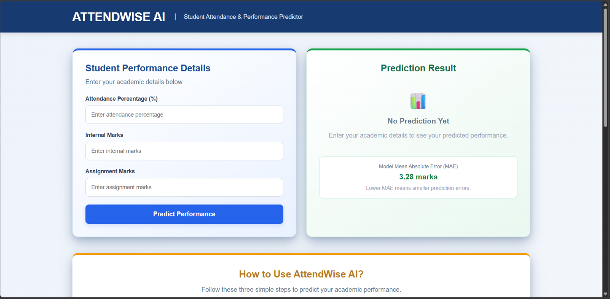

# AttendWise AI 🎓

### Student Attendance & Academic Performance Prediction System

AttendWise AI is a machine learning-based web application designed to analyze student attendance and academic performance and predict student performance using historical academic data.

## 🚀 Features

- Student attendance analysis
- Internal marks evaluation
- Assignment marks evaluation
- Machine Learning-based performance prediction
- Interactive web dashboard
- Student academic performance insights

## 🛠️ Technologies Used

- Python
- Flask
- Pandas
- NumPy
- Scikit-learn
- HTML
- CSS
- JavaScript

## 📂 Project Structure

```text
Attendencewise_ai/
│
├── app.py
├── data/
│   └── student_data.csv
├── static/
│   ├── favicon-192.png
│   ├── script.js
│   └── style.css
├── templates/
│   └── index.html
├── .gitignore
├── requirements.txt
└── README.md
```

## ⚙️ Installation and Setup

### 1. Clone the repository

```bash
git clone https://github.com/Aditya-g028/AttendWise-AI.git
```

### 2. Navigate to the project folder

```bash
cd AttendWise-AI
```

### 3. Create a virtual environment

```bash
python -m venv venv
```

### 4. Activate the virtual environment

Windows PowerShell:

```powershell
.\venv\Scripts\Activate
```

### 5. Install dependencies

```bash
pip install -r requirements.txt
```

### 6. Run the application

```bash
python app.py
```

### 7. Open in your browser

```text
http://127.0.0.1:5000
```

## 🧠 Machine Learning

AttendWise AI uses historical student academic data to predict student performance based on:

- Attendance
- Internal Marks
- Assignment Marks

## 🎯 Project Objective

The main objective of AttendWise AI is to help understand student academic performance through data analysis and machine learning-based predictions.

## 👨‍💻 Developer

**Aditya Gupta**

GitHub: https://github.com/Aditya-g028

---

⭐ If you find this project interesting, consider giving it a star!

## 🖥️ Dashboard Preview

Here is a preview of the AttendWise AI application:

